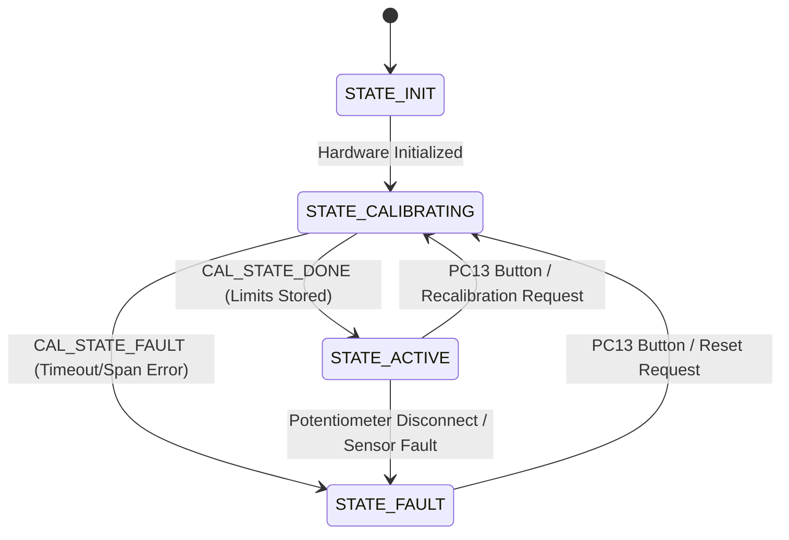
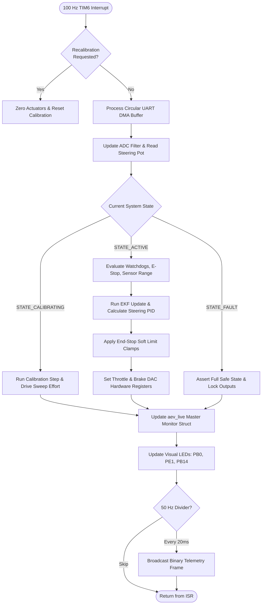

# AEV Core Executive & Real-Time Supervisory Engine (`App/AppCore`)

## 1. Overview
The **AEV Core Executive** ([`app_main.c`](file:///d:/Ph.D%202026-2027/Projects/AEV/STM32/AEV_LowLevel_Controller/AEV_LowLevel_ControllerV1/App/AppCore/app_main.c), [`app_main.h`](file:///d:/Ph.D%202026-2027/Projects/AEV/STM32/AEV_LowLevel_Controller/AEV_LowLevel_ControllerV1/App/AppCore/app_main.h)) serves as the master supervisory scheduler of the Autonomous Electric Vehicle low-level controller.

It coordinates sensor acquisition, motion control algorithms, failsafe watchdogs, hardware DAC/PWM drivers, and telemetry streaming into a deterministic, hard real-time **100 Hz (10 ms)** loop triggered by hardware timer **TIM6**.

---

## 2. System State Machine



### 2.1 State Operational Profiles

| System State | Enumeration | Actions & Actuator State |
| :--- | :--- | :--- |
| **`STATE_INIT`** | `0` | Initializes ADC DMA, DAC channels, PWM timers, circular DMA UART, PID structures, and Kalman filter covariance matrices. Transitions immediately to `STATE_CALIBRATING`. |
| **`STATE_CALIBRATING`** | `1` | Steering sweeps mechanical end-stops with $\pm 45\%$ effort to discover physical limits, compute center, and identify polarity. Throttle is locked to `0.0 V` for safety. Green LED strobes at **5 Hz**. |
| **`STATE_ACTIVE`** | `2` | Closed-loop PID steering active with EKF feedback. Open-loop DAC throttle active ($0\text{--}3.3\text{V}$) when `cmd.acceleration > 0%`. 200 ms watchdog active. Green LED pulses at **1 Hz**. |
| **`STATE_FAULT`** | `3` | Throttle DAC immediately forced to `0.0 V`, Steering PWM set to `0%`, Emergency Brake asserted at `3.3 V`. Red LED flashes diagnostic blink codes. |

---

## 3. Real-Time Execution Loop (`App_Step_100Hz`)

Every 10 ms, the hardware timer interrupt (`TIM6_DAC_IRQHandler`) invokes `App_Step_100Hz()`:



---

## 4. Live Expressions Real-Time Monitoring (`aev_live`)

Add `aev_live` to the **Live Expressions** window in STM32CubeIDE to inspect all internal controller metrics at 100 Hz:

```c
extern volatile VehicleLiveMonitor_t aev_live;
```

| Group | Field Name | Type | Description |
| :--- | :--- | :--- | :--- |
| **`command`** | `drive_direction` | `uint8_t` | `0` = Neutral, `1` = Forward, `2` = Reverse |
| | `steer_angle` | `float` | Commanded wheel angle in degrees ($-30.0^\circ$ to $+30.0^\circ$) |
| | `acceleration` | `float` | Commanded throttle percentage ($0.0\%$ to $100.0\%$) |
| | `brake` | `uint8_t` | `0` = Off, `1` = Partial, `2` = Emergency |
| | `estop` | `uint8_t` | `0` = Normal, `1` = Emergency Stop Active |
| **`steering`** | `target_angle_deg` | `float` | Setpoint target angle in degrees |
| | `actual_angle_deg` | `float` | EKF-filtered angle (auto sign-corrected via `polarity_sign`) |
| | `angle_error_deg` | `float` | Difference ($e = r - y$) |
| | `pot_volts` | `float` | Raw ADC potentiometer voltage ($0.0\text{--}3.3\text{V}$) |
| | `pot_filtered_volts`| `float` | EKF position state estimate $\hat{x}_0$ |
| | `motor_effort` | `float` | PID command output ($-0.60$ to $+0.60$) |
| | `motor_dir_pin` | `uint8_t` | Physical Cytron DIR pin state (`PD14`) |
| | `pwm_duty_pct` | `float` | TIM3 CH1 PWM duty cycle ($0.0\%$ to $100.0\%$) |
| | `angular_vel_v_s` | `float` | EKF estimated velocity state $\hat{x}_1$ in V/s |
| **`drivetrain`** | `throttle_pct` | `float` | Commanded throttle percentage |
| | `throttle_volts` | `float` | Applied DAC1 CH1 output voltage ($0.0\text{--}3.3\text{V}$) |
| | `throttle_dac_raw` | `uint16_t` | 12-bit register counts ($0\text{--}4095$) on pin `PA4` |
| | `brake_volts` | `float` | Applied DAC1 CH2 output voltage ($0.0\text{--}3.3\text{V}$) |
| | `brake_dac_raw` | `uint16_t` | 12-bit register counts ($0\text{--}4095$) on pin `PA5` |
| **`calibration`**| `is_calibrated` | `bool` | `true` once automatic calibration routine completes |
| | `center_volts` | `float` | Mechanical center voltage |
| | `left_limit_volts` | `float` | Left physical end-stop voltage |
| | `right_limit_volts`| `float` | Right physical end-stop voltage |
| | `degrees_per_volt` | `float` | Calibration scale factor ($^\circ/\text{V}$) |
| **`safety`** | `system_state` | `uint8_t` | `0`=INIT, `1`=CALIBRATING, `2`=ACTIVE, `3`=FAULT |
| | `link_alive` | `uint8_t` | `1` if serial packet arrived within 200 ms, `0` if timed out |
| | `watchdog_left_ms` | `uint16_t` | Milliseconds remaining before watchdog triggers |
| | `active_error_code`| `uint8_t` | Active diagnostic fault code (matches Red LED blink count) |
| | `uptime_seconds` | `float` | Continuous system uptime in seconds |
