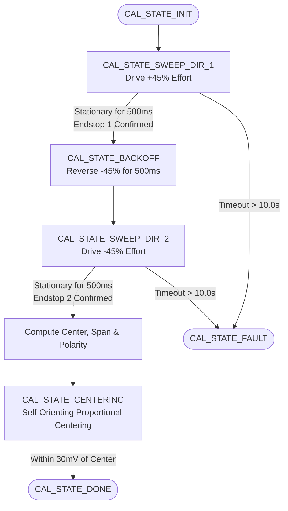

# AEV Motion Control & Auto-Calibrating Steering System (`App/MotionControl`)

## 1. Overview
The **AEV Motion Control Library** ([`calibration.c`](file:///d:/Ph.D%202026-2027/Projects/AEV/STM32/AEV_LowLevel_Controller/AEV_LowLevel_ControllerV1/App/MotionControl/calibration.c), [`calibration.h`](file:///d:/Ph.D%202026-2027/Projects/AEV/STM32/AEV_LowLevel_Controller/AEV_LowLevel_ControllerV1/App/MotionControl/calibration.h), [`pid.c`](file:///d:/Ph.D%202026-2027/Projects/AEV/STM32/AEV_LowLevel_Controller/AEV_LowLevel_ControllerV1/App/MotionControl/pid.c), [`pid.h`](file:///d:/Ph.D%202026-2027/Projects/AEV/STM32/AEV_LowLevel_Controller/AEV_LowLevel_ControllerV1/App/MotionControl/pid.h)) contains all algorithms for:
1. **Self-Discovering Steering Calibration**: Automatically sweeps the steering rack between physical end-stops, discovers mechanical limits, computes scaling factors, and detects hardware wiring polarity.
2. **Closed-Loop Steering PID**: Drives the Cytron steering motor using velocity feedback from the Extended Kalman Filter (EKF) with anti-windup clamping.
3. **Open-Loop Traction Feedforward**: Directly translates host acceleration requests to DAC analog voltages without wheel-encoder PID.

---

## 2. Steering Calibration State Machine



### 2.1 Robust Windowed Stall Detection
The algorithm determines when the steering rack has hit a mechanical end-stop without requiring physical limit switches:
1. **Sweep Torque**: Drives the motor at an authoritative $\pm 45\%$ effort (`CAL_SWEEP_EFFORT = 0.45f`) to overcome tire friction on the floor.
2. **Startup Grace Period (`CAL_STARTUP_GRACE_MS = 600 ms`)**: Motor acceleration is unconstrained for 600 ms so static inertia does not trigger a false stall.
3. **100 ms Sliding Window Filter**:
   $$\Delta V_{\text{window}} = |V_{\text{current}} - V_{\text{100ms\_ago}}|$$
   - If $\Delta V_{\text{window}} > 5\text{ mV}$ ($> 0.05\text{ V/s}$), the rack is actively turning $\to$ stall timer is held at 0.
   - If $\Delta V_{\text{window}} \le 5\text{ mV}$ for a continuous **500 ms** (`CAL_STALL_CONFIRM_MS = 500`), an end-stop is officially recorded.

### 2.2 Automatic Motor Polarity Detection
Different motor wiring, gearbox linkages, or potentiometer orientations can cause positive motor effort to either increase or decrease potentiometer voltage. The calibration sequence auto-detects this:

```c
if (limit_1 > limit_2) {
    results.polarity_sign = 1;  // +effort drove toward higher voltage
} else {
    results.polarity_sign = -1; // +effort drove toward lower voltage
}
```

The runtime PID controller automatically inverts effort when `polarity_sign < 0`, mathematically guaranteeing negative feedback and **eliminating closed-loop runaway**.

### 2.3 Calibration Output Map
Once both end-stops are found:
- **Center Voltage**:
  $$V_{\text{center}} = \frac{V_{\text{low}} + V_{\text{high}}}{2}$$
- **Scale Factor**:
  $$\text{degrees\_per\_volt} = \frac{\text{TOTAL\_STEERING\_ANGLE\_DEG}}{V_{\text{high}} - V_{\text{low}}} \quad (\text{Default } 60.0^\circ \text{ lock-to-lock})$$

---

## 3. Closed-Loop Steering PID Controller

### 3.1 Derivative-on-Measurement Architecture
Traditional PID computes derivative on error: $\frac{d(e)}{dt} = \frac{d(r - y)}{dt}$. An abrupt step in target angle causes severe current spikes ("derivative kick").

Our controller calculates derivative strictly from the **measured EKF velocity**:
$$u(t) = K_p \cdot e(t) + K_i \int e(t)\,dt - K_d \cdot \dot{y}_{\text{EKF}}(t)$$

```c
PID_Init(&steering_pid, 
         5.0f,    // Kp (Proportional Gain)
         1.0f,    // Ki (Integral Gain)
         0.20f,   // Kd (Derivative Gain)
         -0.60f,  // Output Min (-60% PWM effort limit)
         0.60f,   // Output Max (+60% PWM effort limit)
         0.25f);  // Integrator Saturation Anti-Windup Limit
```

### 3.2 End-Stop Current Protection & Soft Clamping
To prevent motors from stalling against physical limits and drawing destructive locked-rotor stall currents ($15\text{A}-30\text{A}+$):
- When the rack is within **40 mV** of `limit_low_v`, any effort commanding further movement into the low stop is clamped to `0.0f`.
- When the rack is within **40 mV** of `limit_high_v`, any effort commanding further movement into the high stop is clamped to `0.0f`.
- When the serial communication link is timed out / offline (`!link_ok`), steering effort is clamped to `0.0f` to relax the motor.

---

## 4. Traction Drive Control (No PID)
**Acceleration does NOT use PID.** Because standard electric vehicle powertrains operate in torque- or velocity-controlled modes via commercial motor controllers (e.g. Curtis, Kelly, Sabvoton):
- Acceleration is **100% open-loop feedforward**:
  $$V_{\text{throttle}} = \left(\frac{\text{cmd.acceleration}}{100.0}\right) \times 3.3\text{ V} \quad (\text{PA4 / DAC1 CH1})$$
- When `cmd.acceleration > 0%`, the throttle voltage is applied immediately.
- When `cmd.estop != 0` or `!link_ok`, throttle is clamped to `0.0 V` and partial/emergency braking is asserted.
