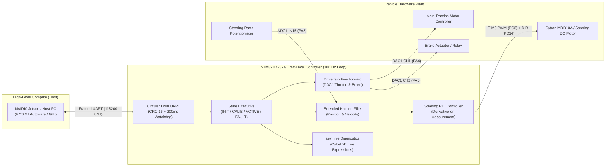

# AEV Low-Level Controller (STM32H723ZG)
### Real-Time Drive-by-Wire Embedded Controller for Autonomous Electric Vehicles

[-002B49?style=flat-square&logo=stmicroelectronics)](https://www.st.com/en/microcontrollers-microprocessors/stm32h723zg.html)
[-10B981?style=flat-square)](App/AppCore/README.md)
[](App/Communication/README.md)
[](LICENSE)

---

## 1. Executive Summary

The **AEV Low-Level Controller** is a high-performance, safety-critical embedded firmware designed for the **STM32 NUCLEO-H723ZG** (ARM Cortex-M7 running at 550 MHz). It acts as the drive-by-wire abstraction bridge between high-level autonomous navigation stacks (such as NVIDIA Jetson Orin/Xavier running ROS 2 / Autoware) and the vehicle's physical powertrain and steering actuators.



---

## 2. Key Capabilities & Engineering Innovations

| Feature | Subsystem | Description |
| :--- | :--- | :--- |
| **Self-Discovering Steering Calibration** | [`App/MotionControl`](file:///d:/Ph.D%202026-2027/Projects/AEV/STM32/AEV_LowLevel_Controller/AEV_LowLevel_ControllerV1/App/MotionControl/README.md) | Authoritative $\pm 45\%$ torque sweep with 100 ms windowed stall detection. Automatically discovers mechanical hardstops, voltage span, degrees/volt factor, and centers the rack. |
| **Automatic Motor Polarity Detection** | [`App/MotionControl`](file:///d:/Ph.D%202026-2027/Projects/AEV/STM32/AEV_LowLevel_Controller/AEV_LowLevel_ControllerV1/App/MotionControl/README.md) | Detects whether positive drive increases or decreases sensor voltage, auto-inverting feedback signs to mathematically eliminate closed-loop runaway. |
| **Endstop Soft Limits & Current Protection** | [`App/AppCore`](file:///d:/Ph.D%202026-2027/Projects/AEV/STM32/AEV_LowLevel_Controller/AEV_LowLevel_ControllerV1/App/AppCore/README.md) | Electronic boundary clamps shut down motor effort within 40 mV of physical stops, eliminating stall current burnouts. |
| **Extended Kalman Filter (EKF)** | [`App/Sensors`](file:///d:/Ph.D%202026-2027/Projects/AEV/STM32/AEV_LowLevel_Controller/AEV_LowLevel_ControllerV1/App/Sensors/README.md) | 2-state Kalman filter estimating true angular position and zero-lag angular velocity directly from 16-bit oversampled ADC DMA data. |
| **Derivative-on-Measurement PID** | [`App/MotionControl`](file:///d:/Ph.D%202026-2027/Projects/AEV/STM32/AEV_LowLevel_Controller/AEV_LowLevel_ControllerV1/App/MotionControl/README.md) | D-term damped using EKF velocity instead of noisy finite-difference error, completely preventing "derivative kick" when target setpoints step abruptly. |
| **True Analog Traction & Brake Output** | [`App/Actuators`](file:///d:/Ph.D%202026-2027/Projects/AEV/STM32/AEV_LowLevel_Controller/AEV_LowLevel_ControllerV1/App/Actuators/README.md) | Dual 12-bit DAC outputs (PA4 Throttle, PA5 Brake) delivering pure 0.0 V to 3.3 V analog signals to commercial motor controllers without PWM ripple. |
| **Zero-CPU UART Reception** | [`App/Communication`](file:///d:/Ph.D%202026-2027/Projects/AEV/STM32/AEV_LowLevel_Controller/AEV_LowLevel_ControllerV1/App/Communication/README.md) | Continuous circular DMA streaming with CRC-16 verification, 50 Hz binary telemetry, and 200 ms failsafe watchdog. |
| **Ground Station Diagnostic GUI** | [`App/Testing`](file:///d:/Ph.D%202026-2027/Projects/AEV/STM32/AEV_LowLevel_Controller/AEV_LowLevel_ControllerV1/App/Testing/README.md) | Full-featured dark-mode Python testing GUI for real-time telemetry plotting, steering dial control, throttle slider, and raw hex packet monitoring. |

---

## 3. Hardware Pinout & Signal Mapping (NUCLEO-H723ZG)

| Subsystem | Signal Name | MCU Pin | Arduino Header | Peripheral Channel | Electrical Interface |
| :--- | :--- | :--- | :--- | :--- | :--- |
| **Steering Sensor** | `STEERING_POT` | **PA3** | **A0** | `ADC1_INP15` | Analog (0.15 V to 3.15 V safe range) |
| **Traction Throttle** | `THROTTLE_DAC` | **PA4** | **A2** | `DAC1_OUT1` | True Analog (0.0 V to 3.3 V) |
| **Electric Brake** | `BRAKE_DAC` | **PA5** | **A3** | `DAC1_OUT2` | True Analog (0.0 V to 3.3 V) |
| **Steering Speed** | `STEER_PWM` | **PC6** | **D9** | `TIM3_CH1` | 550 Hz PWM (0% to 60% active limit) |
| **Steering Direction**| `STEER_DIR` | **PD14** | **D10** | `GPIO_Output` | Digital Level (0 = Left, 1 = Right) |
| **Autonomy Uplink** | `STLK_VCP_RX` | **PD8** | — | `USART3_RX` | Circular DMA (115200 8N1) |
| **Autonomy Downlink**| `STLK_VCP_TX` | **PD9** | — | `USART3_TX` | DMA Stream (115200 8N1) |
| **System Heartbeat** | `SYS_STATUS` | **PB0** | **LD1 (Green)** | `GPIO_Output` | 1 Hz Heartbeat / 5 Hz Calibrating |
| **Serial Link Active**| `COMM_LINK` | **PE1** | **LD2 (Yellow)**| `GPIO_Output` | 10 Hz Flash on valid packets |
| **System Fault Alert**| `SYS_FAULT` | **PB14**| **LD3 (Red)** | `GPIO_Output` | Blinks error code on fault |
| **User Calib Button** | `Motor_Calib` | **PC13**| **B1 (Blue)** | `EXTI15_10` | Falling-Edge Interrupt |

---

## 4. Software Subsystem Directory Guide

Each functional library in `App/` has dedicated documentation:

```
App/
├── AppCore/         # Central 100 Hz real-time state machine & supervisory logic
├── MotionControl/   # Calibration state machine, auto-polarity & EKF-PID steering
├── Actuators/       # DAC1 throttle/brake and TIM3 steering PWM drivers
├── Sensors/         # 16-bit ADC DMA acquisition and 2-state Extended Kalman Filter
├── Communication/   # Binary packet framing, CRC-16, circular DMA & watchdog
├── SafetyMonitor/   # 5-tier safety matrix and failsafe protocols
├── Indicators/      # Non-blocking visual LED patterns and error codes
└── Testing/         # Diagnostics, ASCII self-tests & Python Diagnostic GUI
```

- [`AppCore/README.md`](file:///d:/Ph.D%202026-2027/Projects/AEV/STM32/AEV_LowLevel_Controller/AEV_LowLevel_ControllerV1/App/AppCore/README.md): Supervisory execution, task scheduling, thread-safe calibration requests.
- [`MotionControl/README.md`](file:///d:/Ph.D%202026-2027/Projects/AEV/STM32/AEV_LowLevel_Controller/AEV_LowLevel_ControllerV1/App/MotionControl/README.md): Mathematical derivations for stall detection, auto-polarity, and PID tuning.
- [`Actuators/README.md`](file:///d:/Ph.D%202026-2027/Projects/AEV/STM32/AEV_LowLevel_Controller/AEV_LowLevel_ControllerV1/App/Actuators/README.md): DAC counts formulas, Cytron driver interfacing, and failsafe zeroing.
- [`Sensors/README.md`](file:///d:/Ph.D%202026-2027/Projects/AEV/STM32/AEV_LowLevel_Controller/AEV_LowLevel_ControllerV1/App/Sensors/README.md): ADC DMA block filtering, EKF state equations, and covariance tuning.
- [`Communication/README.md`](file:///d:/Ph.D%202026-2027/Projects/AEV/STM32/AEV_LowLevel_Controller/AEV_LowLevel_ControllerV1/App/Communication/README.md): Packet structures, byte offsets, CRC-16 algorithm, and HTerm hex strings.
- [`SafetyMonitor/README.md`](file:///d:/Ph.D%202026-2027/Projects/AEV/STM32/AEV_LowLevel_Controller/AEV_LowLevel_ControllerV1/App/SafetyMonitor/README.md): Multi-layer safety architecture and boundary enforcement.
- [`Indicators/README.md`](file:///d:/Ph.D%202026-2027/Projects/AEV/STM32/AEV_LowLevel_Controller/AEV_LowLevel_ControllerV1/App/Indicators/README.md): LED flash patterns, blink-code diagnostic lookup table.
- [`Testing/README.md`](file:///d:/Ph.D%202026-2027/Projects/AEV/STM32/AEV_LowLevel_Controller/AEV_LowLevel_ControllerV1/App/Testing/README.md): Step-by-step bench testing instructions and Python GUI manual.

---

## 5. Live Expressions Monitoring (`aev_live`)

Add the master symbol `aev_live` to the **Live Expressions** tab in STM32CubeIDE to inspect all internal states live at 100 Hz without breakpoints:

```c
extern volatile VehicleLiveMonitor_t aev_live;
```

```
aev_live
├── command         # Host Setpoints: drive_direction, steer_angle, acceleration, brake, estop
├── steering        # PID Feedback: target_angle_deg, actual_angle_deg, error, pot_volts, motor_effort
├── drivetrain      # Hardware DACs: throttle_pct, throttle_volts, throttle_dac_raw, brake_volts
├── calibration     # Mechanical Map: is_calibrated, center_volts, left_limit_volts, right_limit_volts
└── safety          # Health: system_state, link_alive, watchdog_left_ms, active_error_code, uptime_seconds
```

---

## 6. Quick-Start Guide

### Building the Firmware
- **In STM32CubeIDE**: Open the workspace, select `AEV_LowLevel_ControllerV1`, and click **Build** (`Ctrl+B`).
- **Via Command Line**:
  ```powershell
  cd Debug
  make -j8 all
  ```

### Launching the Diagnostic GUI
A complete Python ground-station GUI is included in [`App/Testing`](file:///d:/Ph.D%202026-2027/Projects/AEV/STM32/AEV_LowLevel_Controller/AEV_LowLevel_ControllerV1/App/Testing):
```powershell
python App\Testing\aev_diagnostic_gui.py
```
1. Select the ST-Link COM port (`115200 baud`) and click **Connect**.
2. Click **Start 50 Hz Streaming** to satisfy the 200 ms watchdog.
3. Drag the **Steering Angle** slider or **Throttle Effort** slider to control the vehicle in real time.
